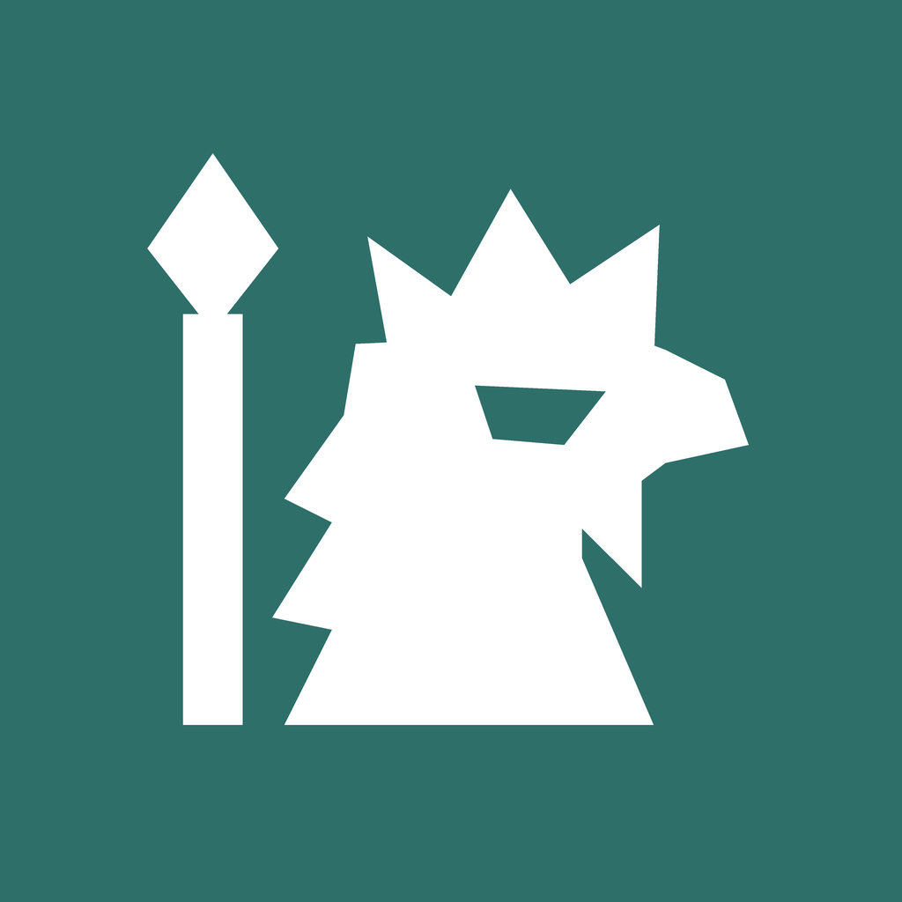

   
  <a href="#di-cosa-si-tratta">Informazioni</a> |
  <a href="#segnalare-un-errore">Segnalare un errore</a> |
  <a href="#per-gli-sviluppatori">Per gli sviluppatori</a> 
  [<a href="../README.md">English</a>] | [<a href="README-KR.md">한국어</a>] | [<a href="README-JP.md">日本語</a>] | [<a href="README-ZH.md">简体中文</a>] | [<a href="README-TW.md">繁體中文</a>] | [<a href="README-ES.md">Español</a>] | [<a href="README-PTBR.md">Português (Brasil)</a>] | [<a href="README-FR.md">Français</a>] | [<a href="README-DE.md">Deutsch</a>] | [<a href="README-IT.md">Italiano</a>] | [<a href="README-RU.md">Русский</a>] | [<a href="README-PL.md">Polski</a>] | [<a href="README-TR.md">Türkçe</a>] | [<a href="README-ID.md">Bahasa Indonesia</a>] | [<a href="README-VN.md">Tiếng Việt</a>] | [<a href="README-TH.md">ไทย</a>] | [<a href="README-AR.md">العربية</a>] | [<a href="README-HI.md">हिन्दी</a>]

# Nunmasae Companion

Una guida non ufficiale e senza spoiler, creata dai fan, per il romanzo fantasy coreano "The Bird That Drinks Tears" (눈물을 마시는 새). Mostra personaggi, luoghi e termini solo fino al libro che hai letto.

> [!NOTE]
> Le schermate dell'app sono solo in inglese e coreano. Questo README è stato tradotto automaticamente con Claude; le correzioni sono benvenute.

## Di cosa si tratta

- Scegli fin dove sei arrivato a leggere (libri da 1 a 4). L'app mostra solo i personaggi, le razze, i luoghi e i termini comparsi fino a quel punto e, in ogni voce, solo i fatti rivelati fino ad allora.
- Le voci e i fatti dei libri che non hai letto non vengono sfocati: semplicemente non vengono mostrati, così non se ne vede nemmeno il numero.
- I grandi colpi di scena del libro che stai leggendo restano coperti nella schermata di dettaglio finché non li tocchi.
- Schermate in inglese e in coreano. La schermata in inglese mostra anche i nomi coreani, così puoi abbinarli all'originale.
- Niente pubblicità, niente donazioni, niente funzioni a pagamento, niente login, niente server. Sul tuo dispositivo vengono salvati solo i tuoi progressi di lettura e la lingua scelta.
- Scaricala: Google Play (presto disponibile)

## Segnalare un errore

I fatti sono riassunti da fonti secondarie, non dai libri stessi, quindi alcuni potrebbero essere sbagliati o assegnati al libro sbagliato. Faccelo sapere e lo correggeremo.

- Nell'app: Settings (Impostazioni) > "Report on GitHub" (Segnala su GitHub) o "Report by email" (Segnala via email)
- [Apri una issue su GitHub](https://github.com/HanJaeJoon/nunmasae-companion/issues/new/choose) e scegli un modulo: fatto errato / rivelato troppo presto (spoiler) / nome inglese / fatto mancante
- Correggilo tu e invia una pull request: [CONTRIBUTING.md](CONTRIBUTING.md)

**Attenzione agli spoiler**: se il titolo o il testo della tua issue può rovinare qualcosa a chi non ha finito di leggere, scrivi `[Spoiler Book N]` nella prima riga.

## Non ufficiale

Questo è un progetto di fan, non affiliato all'autore, agli editori (Golden Bough, HarperCollins) né a Krafton. Nomi, ambientazione e termini appartengono all'opera originale; ogni frase sui fatti nell'app è un riassunto originale. Nessuna citazione dai libri, nessuna copertina, nessuna illustrazione. Se un titolare dei diritti lo richiede, rimuoviamo subito il contenuto.

## Per gli sviluppatori

- Guida per contribuire (in inglese): [CONTRIBUTING.md](CONTRIBUTING.md)
- Documentazione per sviluppatori (schermate, struttura del codice, formato dei dati, comandi; solo in coreano): [DEVELOPMENT.md](DEVELOPMENT.md)

Expo SDK 57 / React Native 0.86 / expo-router / TypeScript. Il gestore di pacchetti è pnpm.

## Licenza

Codice: vedi `LICENSE`. Nomi dei personaggi, luoghi e termini appartengono all'opera originale; tutte le frasi sui fatti in `entries.json` sono riassunti originali scritti per questa app.
